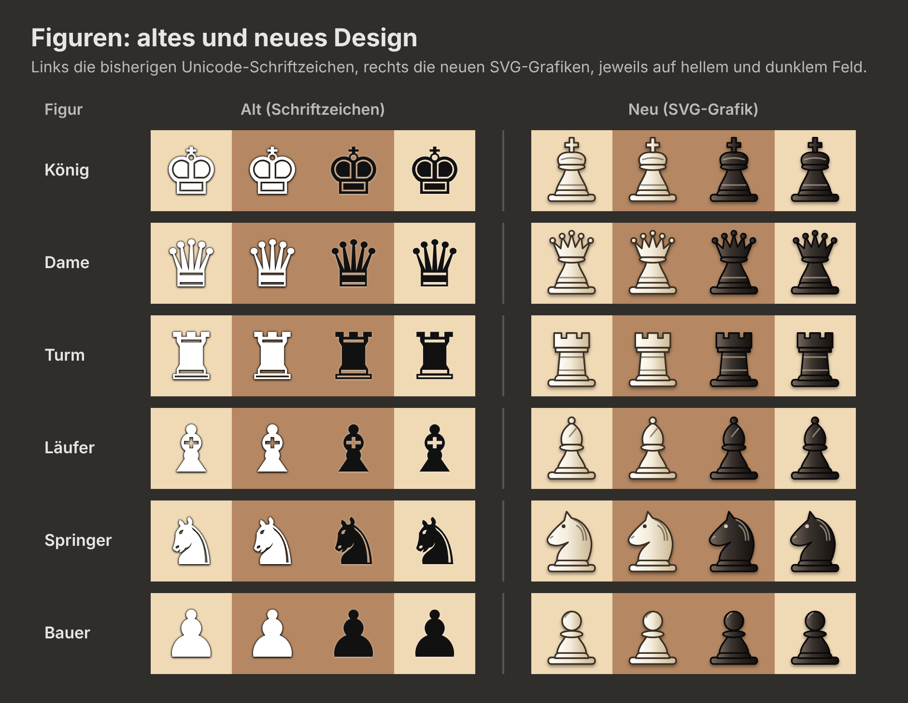

# HAW Schach

Ein Schachspiel als Webseite, entwickelt im Dialog mit einer KI. Es ist ein Lehrexperiment, das zeigt, wie man gemeinsam mit KI Software baut.

## Starten

**Einfach:** `index.html` im Browser öffnen.

**Empfohlen:** über einen kleinen lokalen Webserver starten. Dann rechnet der Computergegner in einem eigenen Thread (Web Worker), und die Seite bleibt flüssig, auch während er nachdenkt:

```bash
python3 -m http.server 8000
```

Anschließend <http://localhost:8000> öffnen.

## Funktionen

- **Spielmodi:** Jede Seite wird von einem Menschen oder vom Computer gespielt. Damit sind möglich:
  - Hotseat (zwei Menschen am selben Rechner),
  - Mensch gegen Computer,
  - Computer gegen Computer.
- **Schwierigkeitsgrade:** Leicht, Mittel, Stark und Profi.
- **Computer übernimmt:** Über die Auswahl „Gespielt von“ lässt sich jederzeit während der Partie wechseln, in beide Richtungen.
- **Schachuhr (optional):** Bedenkzeit pro Person plus Zeitgutschrift pro Zug, zum Beispiel 3 + 2 oder 15 + 10. Wird vor Spielbeginn festgelegt.
- **Alle FIDE-Zugregeln:** Rochade, en passant und Bauernumwandlung.
- **Spielende:**
  - Schachmatt, Aufgeben und Zeitablauf.
  - Remis durch Patt, ungenügendes Material, 50-Züge-Regel, dreifache Stellungswiederholung oder Einigung.
- **Zugliste** in deutscher Notation (K, D, T, L, S).

## Aufbau

| Datei | Aufgabe |
|---|---|
| `index.html` | Seitenstruktur und Dialoge |
| `css/style.css` | Aussehen |
| `js/pieces.js` | Eigene Figurengrafiken (SVG) |
| `js/chess.js` | Spielregeln, unabhängig von der Darstellung |
| `js/engine.js` | Computergegner (Alpha-Beta-Suche mit Stellungsbewertung) |
| `js/engine-worker.js` | Startet den Computergegner in einem eigenen Thread |
| `js/main.js` | Darstellung, Bedienung, Schachuhr, Spielablauf |
| `tests/` | Automatische Tests |

## Tests

```bash
node tests/perft.test.js
node tests/engine.test.js
```

## Figurendesign

Gegenüberstellung der bisherigen Schriftzeichen (links) und der eigenen SVG-Figuren (rechts):


